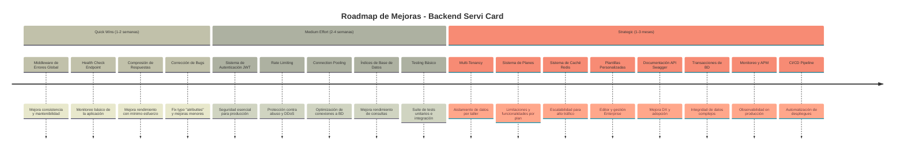
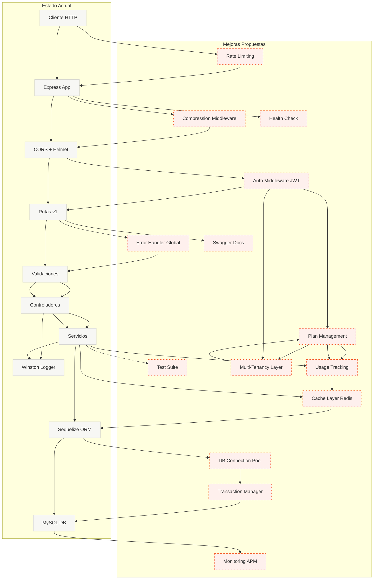

# Roadmap: Mejoras para Escalabilidad y Robustez

## 📊 Análisis del Estado Actual

### Fortalezas Identificadas

- ✅ Arquitectura en capas bien definida (Rutas → Controladores → Servicios → Modelos)
- ✅ Sistema de logging robusto con Winston y rotación de archivos
- ✅ Validación de datos con express-validator
- ✅ Seguridad básica con Helmet y CORS configurado
- ✅ Paginación implementada para evitar sobrecarga
- ✅ Validación de variables de entorno con envalid

### Áreas de Oportunidad

- ❌ **Autenticación y Autorización**: No implementada
- ❌ **Manejo de Errores Centralizado**: Inconsistente entre controladores
- ❌ **Caché**: No hay sistema de caché para consultas frecuentes
- ❌ **Rate Limiting**: Sin protección contra abuso de API
- ❌ **Testing**: No hay suite de tests implementada
- ❌ **Documentación API**: Falta Swagger/OpenAPI
- ❌ **Transacciones DB**: No se usan transacciones para operaciones complejas
- ❌ **Connection Pooling**: No configurado explícitamente
- ❌ **Health Checks**: Sin endpoint de monitoreo
- ❌ **Índices de BD**: Falta optimización de índices para búsquedas
- ❌ **Compresión**: Sin compresión de respuestas HTTP
- ❌ **Monitoreo/APM**: Sin sistema de monitoreo de aplicación
- ❌ **Multi-Tenancy**: No hay aislamiento de datos entre talleres
- ❌ **Sistema de Planes**: Sin limitaciones ni diferenciación de funcionalidades

---

## 🗺️ Timeline de Mejoras



---

## 🔄 Diagrama: Estado Actual vs Propuesto



---

## 📋 Lista Priorizada de Mejoras

### 🔴 Quick Wins (Alto Impacto, Bajo Esfuerzo)

#### 1. Middleware de Manejo de Errores Global

**Prioridad:** Alta  
**Esfuerzo:** 2-4 horas  
**Impacto:** Alto

**Descripción:**
Crear un middleware centralizado para manejar todos los errores de forma consistente, eliminando código duplicado en controladores.

**Beneficios:**

- Respuestas de error consistentes
- Menos código duplicado
- Mejor mantenibilidad
- Logging centralizado de errores

**Implementación:**

```javascript
// middleware/errorHandler.js
const errorHandler = (err, req, res, next) => {
  logger.api.error("Error:", {
    message: err.message,
    stack: err.stack,
    path: req.path,
    method: req.method,
  });

  const statusCode = err.statusCode || 500;
  res.status(statusCode).json({
    error: {
      message: err.message || "Error interno del servidor",
      ...(process.env.ENVIRONMENT === "development" && { stack: err.stack }),
    },
  });
};
```

---

#### 2. Health Check Endpoint

**Prioridad:** Alta  
**Esfuerzo:** 1-2 horas  
**Impacto:** Medio-Alto

**Descripción:**
Endpoint `/health` para monitoreo de la aplicación y verificación de estado de servicios dependientes (BD, etc.).

**Beneficios:**

- Monitoreo básico de salud
- Integración con sistemas de orquestación (Kubernetes, Docker)
- Detección temprana de problemas

**Implementación:**

```javascript
// routes/health.js
router.get("/health", async (req, res) => {
  const healthCheck = {
    uptime: process.uptime(),
    message: "OK",
    timestamp: Date.now(),
    database: "disconnected",
  };

  try {
    await models.sequelize.authenticate();
    healthCheck.database = "connected";
    res.status(200).json(healthCheck);
  } catch (error) {
    healthCheck.database = "disconnected";
    res.status(503).json(healthCheck);
  }
});
```

---

#### 3. Compresión de Respuestas HTTP

**Prioridad:** Media  
**Esfuerzo:** 30 minutos  
**Impacto:** Medio

**Descripción:**
Implementar compresión gzip/brotli para reducir el tamaño de las respuestas HTTP.

**Beneficios:**

- Menor uso de ancho de banda
- Respuestas más rápidas
- Mejor experiencia de usuario

**Implementación:**

```javascript
const compression = require("compression");
app.use(compression());
```

---

#### 4. Corrección de Bugs y Mejoras Menores

**Prioridad:** Alta  
**Esfuerzo:** 1 hora  
**Impacto:** Medio

**Bugs Identificados:**

- Typo en `services/serviCard.js` línea 14: `atributtes` → `attributes`
- Uso inconsistente de `console.log` vs `logger` en controladores
- Falta validación de `null` en `getServiCardById`

---

### 🟡 Medium Effort (Impacto Medio-Alto, Esfuerzo Medio)

#### 5. Sistema de Autenticación JWT

**Prioridad:** Crítica  
**Esfuerzo:** 1-2 semanas  
**Impacto:** Crítico

**Descripción:**
Implementar autenticación basada en JWT para proteger los endpoints de la API.

**Componentes:**

- Modelo de Usuario
- Endpoints de registro/login
- Middleware de autenticación
- Refresh tokens
- Hash de contraseñas con bcrypt

**Beneficios:**

- Seguridad esencial para producción
- Control de acceso a recursos
- Auditoría de acciones de usuarios

**Estructura Propuesta:**

```
models/
  └── user.js
controllers/
  └── auth.js
middleware/
  └── authenticate.js
routes/
  └── auth.js
```

---

#### 6. Rate Limiting

**Prioridad:** Alta  
**Esfuerzo:** 4-8 horas  
**Impacto:** Alto

**Descripción:**
Implementar límites de tasa de solicitudes para prevenir abuso y ataques DDoS.

**Beneficios:**

- Protección contra abuso de API
- Prevención de ataques DDoS básicos
- Control de costos de infraestructura

**Implementación:**

```javascript
const rateLimit = require("express-rate-limit");

const apiLimiter = rateLimit({
  windowMs: 15 * 60 * 1000, // 15 minutos
  max: 100, // límite de 100 requests por IP
  message: "Demasiadas solicitudes desde esta IP",
});

app.use("/api/v1/", apiLimiter);
```

---

#### 7. Connection Pooling Optimizado

**Prioridad:** Media  
**Esfuerzo:** 2-4 horas  
**Impacto:** Medio-Alto

**Descripción:**
Configurar explícitamente el pool de conexiones de Sequelize para optimizar el rendimiento.

**Beneficios:**

- Mejor manejo de conexiones concurrentes
- Reducción de latencia
- Prevención de agotamiento de conexiones

**Implementación:**

```javascript
// config/config.js
const config = {
  pool: {
    max: 5,
    min: 0,
    acquire: 30000,
    idle: 10000,
  },
};
```

---

#### 8. Índices de Base de Datos

**Prioridad:** Media  
**Esfuerzo:** 2-3 horas  
**Impacto:** Medio-Alto

**Descripción:**
Crear índices en campos frecuentemente consultados para mejorar el rendimiento de las búsquedas.

**Índices Propuestos:**

- `patent` (búsquedas frecuentes)
- `date` (ordenamiento)
- `createdAt` (filtros temporales)

**Implementación:**

```javascript
// migrations/XXXX-add-indexes.js
await queryInterface.addIndex("ServiCars", ["patent"], {
  name: "idx_patent",
});
await queryInterface.addIndex("ServiCars", ["date"], {
  name: "idx_date",
});
```

---

#### 9. Suite de Testing

**Prioridad:** Alta  
**Esfuerzo:** 1-2 semanas  
**Impacto:** Alto

**Descripción:**
Implementar tests unitarios, de integración y end-to-end.

**Stack Propuesto:**

- Jest o Mocha para testing framework
- Supertest para testing de API
- Faker para datos de prueba

**Cobertura Objetivo:**

- Servicios: 80%+
- Controladores: 70%+
- Helpers: 90%+

**Estructura:**

```
tests/
  ├── unit/
  │   ├── services/
  │   └── helpers/
  ├── integration/
  │   └── api/
  └── fixtures/
```

---

### 🟢 Strategic (Alto Impacto, Alto Esfuerzo)

#### 10. Sistema Multi-Tenant

**Prioridad:** Crítica  
**Esfuerzo:** 2-3 semanas  
**Impacto:** Crítico (para modelo de negocio SaaS)

**Descripción:**
Implementar arquitectura multi-tenant que permita que múltiples talleres mecánicos usen la misma aplicación de forma aislada, donde cada taller solo puede acceder a sus propios datos.

**Estrategia Recomendada: Shared Database, Shared Schema con Tenant ID**

Esta es la estrategia más escalable y mantenible:

- Una sola base de datos compartida
- Todas las tablas incluyen `tenant_id` o `workshop_id`
- Middleware automático filtra por tenant en todas las consultas
- Índices compuestos para optimizar búsquedas multi-tenant

**Componentes Necesarios:**

1. **Modelo de Tenant/Workshop:**

   - Información del taller (nombre, dirección, contacto)
   - Configuración específica del taller
   - Estado de suscripción

2. **Middleware de Tenant Context:**

   - Extrae tenant_id del JWT o header
   - Inyecta automáticamente en todas las consultas
   - Valida que el usuario pertenezca al tenant

3. **Scopes Globales en Sequelize:**

   - Scope automático que filtra por tenant_id
   - Previene acceso accidental a datos de otros tenants

4. **Migraciones de Datos:**
   - Agregar `workshop_id` a todas las tablas existentes
   - Migrar datos existentes (asignar a tenant por defecto)
   - Crear índices compuestos

**Beneficios:**

- Aislamiento completo de datos entre talleres
- Escalabilidad horizontal
- Mantenimiento simplificado (una sola BD)
- Facilita implementación de sistema de planes
- Base para facturación por tenant

**Implementación:**

```javascript
// models/workshop.js
module.exports = (sequelize, DataTypes) => {
  const Workshop = sequelize.define("Workshop", {
    id: {
      type: DataTypes.UUID,
      defaultValue: DataTypes.UUIDV4,
      primaryKey: true,
    },
    name: DataTypes.STRING,
    email: DataTypes.STRING,
    phone: DataTypes.STRING,
    address: DataTypes.TEXT,
    plan_id: DataTypes.INTEGER, // Relación con Plan
    status: {
      type: DataTypes.ENUM("active", "suspended", "cancelled"),
      defaultValue: "active",
    },
    subscription_expires_at: DataTypes.DATE,
  });
  return Workshop;
};

// models/servicar.js - Modificado
ServiCar.init(
  {
    workshop_id: {
      type: DataTypes.UUID,
      allowNull: false,
      references: {
        model: "Workshops",
        key: "id",
      },
    },
    patent: DataTypes.STRING,
    // ... resto de campos
  },
  {
    sequelize,
    modelName: "ServiCar",
    defaultScope: {
      // Scope por defecto siempre filtra por tenant
      // Se sobrescribe en middleware
    },
    scopes: {
      byWorkshop(workshopId) {
        return {
          where: { workshop_id: workshopId },
        };
      },
    },
  }
);

// middleware/tenantContext.js
const setTenantContext = async (req, res, next) => {
  // Extraer workshop_id del JWT o header
  const workshopId = req.user?.workshop_id || req.headers["x-workshop-id"];

  if (!workshopId) {
    return res.status(403).json({ error: "Workshop context required" });
  }

  // Verificar que el usuario pertenece al workshop
  const userWorkshop = await User.findByPk(req.user.id, {
    include: [{ model: Workshop, where: { id: workshopId } }],
  });

  if (!userWorkshop) {
    return res.status(403).json({ error: "Unauthorized workshop access" });
  }

  // Inyectar en request para uso en servicios
  req.workshopId = workshopId;
  next();
};

// services/serviCard.js - Modificado
const getServiCardAll = async (req, res) => {
  const { page, size, search } = req.query;
  const { limit, offset } = await getPagination(page, size);

  const condition = {
    workshop_id: req.workshopId, // Siempre filtrar por tenant
    ...(search && { patent: { [Op.substring]: search } }),
  };

  const cards = await ServiCar.findAndCountAll({
    where: condition,
    limit,
    offset,
    order: [["date", "DESC"]],
  });

  return await PaginateData(cards, page, limit);
};
```

**Migración:**

```javascript
// migrations/XXXX-add-multi-tenant.js
module.exports = {
  async up(queryInterface, Sequelize) {
    // 1. Crear tabla Workshops
    await queryInterface.createTable("Workshops", {
      id: {
        type: Sequelize.UUID,
        defaultValue: Sequelize.UUIDV4,
        primaryKey: true,
      },
      name: Sequelize.STRING,
      email: Sequelize.STRING,
      plan_id: Sequelize.INTEGER,
      status: Sequelize.ENUM("active", "suspended", "cancelled"),
      createdAt: Sequelize.DATE,
      updatedAt: Sequelize.DATE,
    });

    // 2. Agregar workshop_id a ServiCars
    await queryInterface.addColumn("ServiCars", "workshop_id", {
      type: Sequelize.UUID,
      allowNull: true, // Temporalmente nullable para migración
      references: {
        model: "Workshops",
        key: "id",
      },
    });

    // 3. Crear workshop por defecto y asignar datos existentes
    const [workshop] = await queryInterface.sequelize.query(
      "INSERT INTO Workshops (id, name, email, status, createdAt, updatedAt) VALUES (UUID(), 'Default Workshop', 'default@example.com', 'active', NOW(), NOW())"
    );

    await queryInterface.sequelize.query(
      `UPDATE ServiCars SET workshop_id = (SELECT id FROM Workshops LIMIT 1) WHERE workshop_id IS NULL`
    );

    // 4. Hacer workshop_id NOT NULL
    await queryInterface.changeColumn("ServiCars", "workshop_id", {
      type: Sequelize.UUID,
      allowNull: false,
    });

    // 5. Crear índices compuestos
    await queryInterface.addIndex("ServiCars", ["workshop_id", "patent"], {
      name: "idx_workshop_patent",
    });
    await queryInterface.addIndex("ServiCars", ["workshop_id", "date"], {
      name: "idx_workshop_date",
    });
  },

  async down(queryInterface, Sequelize) {
    await queryInterface.removeIndex("ServiCars", "idx_workshop_date");
    await queryInterface.removeIndex("ServiCars", "idx_workshop_patent");
    await queryInterface.removeColumn("ServiCars", "workshop_id");
    await queryInterface.dropTable("Workshops");
  },
};
```

---

#### 11. Sistema de Planes y Limitaciones

**Prioridad:** Crítica  
**Esfuerzo:** 2-3 semanas  
**Impacto:** Crítico (monetización)

**Descripción:**
Implementar sistema de planes de suscripción con limitaciones específicas por plan, permitiendo diferentes niveles de servicio según el plan contratado por cada taller.

**Planes Propuestos:**

##### Plan Básico (Starter)

- **Precio:** Gratis o bajo costo
- **Limitaciones:**
  - Máximo 50 tarjetas de servicio activas
  - Máximo 2 usuarios/empleados
  - Historial limitado a 6 meses
  - Sin reportes avanzados
  - Sin exportación de datos
  - Sin integraciones API
  - Soporte por email solamente

##### Plan Profesional (Professional)

- **Precio:** Medio
- **Limitaciones:**
  - Máximo 500 tarjetas de servicio activas
  - Máximo 10 usuarios/empleados
  - Historial completo (sin límite de tiempo)
  - Reportes básicos incluidos
  - Exportación a PDF/Excel
  - API básica (rate limit: 1000 req/día)
  - Soporte prioritario por email
  - Backup automático semanal

##### Plan Empresarial (Enterprise)

- **Precio:** Alto
- **Limitaciones:**
  - Tarjetas ilimitadas
  - Usuarios ilimitados
  - Historial completo
  - Reportes avanzados y analytics
  - Exportación completa (múltiples formatos)
  - API completa (rate limit: 10000 req/día)
  - Integraciones personalizadas
  - Soporte 24/7 (email, chat, teléfono)
  - Backup automático diario
  - White-label (personalización de marca)
  - Acceso a API de webhooks
  - **Plantillas personalizadas de tarjetas** (editor visual, subida de diseños, branding completo)

**Componentes del Sistema:**

1. **Modelo de Plan:**

   ```javascript
   // models/plan.js
   {
     id: INTEGER,
     name: STRING, // 'starter', 'professional', 'enterprise'
     display_name: STRING,
     price: DECIMAL,
     billing_cycle: ENUM('monthly', 'yearly'),
     limits: JSON, // Almacena todas las limitaciones
     features: JSON, // Lista de características habilitadas
     is_active: BOOLEAN
   }
   ```

2. **Modelo de Límites:**

   ```javascript
   // Estructura del JSON limits
   {
     max_service_cards: 50,
     max_users: 2,
     max_history_months: 6,
     max_api_requests_per_day: 0,
     features: {
       advanced_reports: false,
       data_export: false,
       api_access: false,
       webhooks: false,
       white_label: false,
       custom_integrations: false
     },
     support: {
       channels: ['email'],
       response_time_hours: 48,
       priority: 'standard'
     },
     backup: {
       frequency: 'none', // 'none', 'weekly', 'daily'
       retention_days: 0
     }
   }
   ```

3. **Middleware de Validación de Límites:**

   ```javascript
   // middleware/planLimits.js
   const checkPlanLimit = async (req, res, next) => {
     const workshop = await Workshop.findByPk(req.workshopId, {
       include: [{ model: Plan }],
     });

     const limit = req.route.limit; // Definido en ruta
     const currentUsage = await getCurrentUsage(req.workshopId, limit.type);

     if (currentUsage >= workshop.Plan.limits[limit.key]) {
       return res.status(403).json({
         error: "Plan limit exceeded",
         limit: limit.key,
         current: currentUsage,
         max: workshop.Plan.limits[limit.key],
         upgrade_url: `/billing/upgrade`,
       });
     }

     next();
   };
   ```

4. **Servicio de Uso y Tracking:**

   ```javascript
   // services/usageTracking.js
   const trackUsage = async (workshopId, resourceType, amount = 1) => {
     await UsageTracking.create({
       workshop_id: workshopId,
       resource_type: resourceType, // 'service_card', 'api_request', etc.
       amount,
       date: new Date(),
     });
   };

   const getCurrentUsage = async (
     workshopId,
     resourceType,
     period = "current_month"
   ) => {
     const usage = await UsageTracking.sum("amount", {
       where: {
         workshop_id: workshopId,
         resource_type: resourceType,
         date: getPeriodDates(period),
       },
     });
     return usage || 0;
   };
   ```

5. **Validación en Servicios:**

   ```javascript
   // services/serviCard.js - Modificado
   const createServiCard = async (serviCardData, workshopId) => {
     // Verificar límite de tarjetas
     const workshop = await Workshop.findByPk(workshopId, {
       include: [{ model: Plan }],
     });

     const currentCount = await ServiCar.count({
       where: { workshop_id: workshopId },
     });

     if (currentCount >= workshop.Plan.limits.max_service_cards) {
       throw new Error("MAX_SERVICE_CARDS_EXCEEDED");
     }

     // Crear tarjeta
     const serviCard = await ServiCar.create({
       ...serviCardData,
       workshop_id: workshopId,
     });

     // Track usage
     await trackUsage(workshopId, "service_card", 1);

     return serviCard;
   };
   ```

6. **Endpoints de Billing:**
   ```javascript
   // routes/billing.js
   router.get("/plans", getAvailablePlans);
   router.post("/subscribe", authenticate, subscribeToPlan);
   router.post("/upgrade", authenticate, upgradePlan);
   router.post("/downgrade", authenticate, downgradePlan);
   router.get("/usage", authenticate, getCurrentUsage);
   router.get("/limits", authenticate, getPlanLimits);
   ```

**Implementación de Limitaciones Específicas:**

```javascript
// helpers/planLimits.js
const PLAN_LIMITS = {
  starter: {
    max_service_cards: 50,
    max_users: 2,
    max_history_months: 6,
    max_api_requests_per_day: 0,
    features: {
      advanced_reports: false,
      data_export: false,
      api_access: false,
      webhooks: false,
      white_label: false,
      custom_templates: false,
    },
  },
  professional: {
    max_service_cards: 500,
    max_users: 10,
    max_history_months: null, // ilimitado
    max_api_requests_per_day: 1000,
    features: {
      advanced_reports: true,
      data_export: true,
      api_access: true,
      webhooks: false,
      white_label: false,
      custom_templates: false,
    },
  },
  enterprise: {
    max_service_cards: null, // ilimitado
    max_users: null, // ilimitado
    max_history_months: null,
    max_api_requests_per_day: 10000,
    features: {
      advanced_reports: true,
      data_export: true,
      api_access: true,
      webhooks: true,
      white_label: true,
      custom_templates: true, // Plantillas personalizadas
    },
  },
};

const checkFeature = async (workshopId, feature) => {
  const workshop = await Workshop.findByPk(workshopId, {
    include: [{ model: Plan }],
  });

  return workshop.Plan.limits.features[feature] === true;
};

const enforceHistoryLimit = async (workshopId) => {
  const workshop = await Workshop.findByPk(workshopId, {
    include: [{ model: Plan }],
  });

  if (workshop.Plan.limits.max_history_months === null) {
    return; // Sin límite
  }

  const cutoffDate = new Date();
  cutoffDate.setMonth(
    cutoffDate.getMonth() - workshop.Plan.limits.max_history_months
  );

  // Archivar o eliminar registros antiguos
  await ServiCar.update(
    { archived: true },
    {
      where: {
        workshop_id: workshopId,
        date: { [Op.lt]: cutoffDate },
      },
    }
  );
};
```

**Beneficios:**

- Modelo de negocio SaaS escalable
- Diferentes niveles de servicio según necesidades
- Monetización clara y estructurada
- Facilita crecimiento del negocio
- Permite ofrecer planes personalizados

**Consideraciones Importantes:**

1. **Migración de Datos Existentes:**

   - Asignar plan "Starter" a todos los talleres existentes
   - Notificar sobre limitaciones del plan gratuito
   - Ofrecer período de gracia para migración

2. **Comunicación de Límites:**

   - Mostrar límites claramente en UI
   - Alertas cuando se aproximen a los límites (80%, 90%, 100%)
   - Mensajes claros cuando se excedan límites

3. **Upgrade/Downgrade:**

   - Proceso sencillo de cambio de plan
   - Manejar prorrateo de facturación
   - Validar que downgrade no cause pérdida de datos

4. **Enforcement Suave vs Estricto:**
   - Opción 1: Bloquear completamente al exceder límite
   - Opción 2: Permitir exceder con advertencias (mejor UX)
   - Recomendación: Enforcement estricto con período de gracia

---

#### 12. Sistema de Caché con Redis

**Prioridad:** Media  
**Esfuerzo:** 1-2 semanas  
**Impacto:** Alto (a largo plazo)

**Descripción:**
Implementar caché con Redis para consultas frecuentes y reducir carga en la base de datos.

**Casos de Uso:**

- Caché de listados paginados
- Caché de búsquedas frecuentes
- Invalidación inteligente de caché

**Beneficios:**

- Reducción significativa de carga en BD
- Respuestas más rápidas
- Escalabilidad mejorada

**Implementación:**

```javascript
const redis = require("redis");
const client = redis.createClient();

const getCachedData = async (key) => {
  const cached = await client.get(key);
  return cached ? JSON.parse(cached) : null;
};

const setCachedData = async (key, data, ttl = 3600) => {
  await client.setEx(key, ttl, JSON.stringify(data));
};
```

---

#### 13. Documentación API con Swagger/OpenAPI

**Prioridad:** Media  
**Esfuerzo:** 1 semana  
**Impacto:** Medio-Alto

**Descripción:**
Generar documentación interactiva de la API usando Swagger/OpenAPI.

**Beneficios:**

- Mejor experiencia para desarrolladores
- Documentación siempre actualizada
- Testing interactivo de endpoints
- Generación automática de clientes SDK

**Stack Propuesto:**

- swagger-jsdoc
- swagger-ui-express

---

#### 14. Transacciones de Base de Datos

**Prioridad:** Media  
**Esfuerzo:** 3-5 días  
**Impacto:** Medio

**Descripción:**
Implementar transacciones para operaciones complejas que requieren consistencia.

**Casos de Uso:**

- Creación de múltiples registros relacionados
- Actualizaciones que afectan múltiples tablas
- Operaciones de eliminación en cascada

**Implementación:**

```javascript
const transaction = await models.sequelize.transaction();
try {
  await Model1.create(data1, { transaction });
  await Model2.create(data2, { transaction });
  await transaction.commit();
} catch (error) {
  await transaction.rollback();
  throw error;
}
```

---

#### 15. Monitoreo y APM (Application Performance Monitoring)

**Prioridad:** Media  
**Esfuerzo:** 1 semana  
**Impacto:** Alto (en producción)

**Descripción:**
Implementar sistema de monitoreo para métricas de rendimiento y alertas.

**Opciones:**

- Prometheus + Grafana
- New Relic
- Datadog
- Sentry (para errores)

**Métricas a Monitorear:**

- Tiempo de respuesta de endpoints
- Tasa de errores
- Uso de CPU/Memoria
- Conexiones a BD
- Throughput de requests

---

#### 16. Sistema de Plantillas Personalizadas (Enterprise)

**Prioridad:** Media-Alta  
**Esfuerzo:** 2-3 semanas  
**Impacto:** Alto (diferenciador competitivo)

**Descripción:**
Implementar sistema completo de gestión de plantillas personalizadas para tarjetas de servicio. Permite a talleres del plan Enterprise crear, almacenar y aplicar diseños personalizados a sus tarjetas, incluyendo logos, colores, fuentes y layouts personalizados.

**Componentes del Sistema:**

1. **Modelo de Plantilla:**

   ```javascript
   // models/template.js
   {
     id: UUID,
     workshop_id: UUID,
     name: STRING,
     description: TEXT,
     design_config: JSON, // Configuración de diseño
     logo_url: STRING,
     is_active: BOOLEAN,
     is_default: BOOLEAN,
     created_at: DATE,
     updated_at: DATE
   }
   ```

2. **Almacenamiento de Archivos:**

   - Logos e imágenes de plantillas
   - Integración con S3/Cloudinary
   - Validación de tipos y tamaños
   - Compresión automática

3. **Generación de PDFs Personalizados:**

   - Renderizado de tarjetas con plantilla
   - Inclusión de branding del taller
   - Exportación en múltiples formatos

4. **Endpoints de API:**

   ```javascript
   // routes/templates.js
   GET    /templates              // Listar plantillas del taller
   GET    /templates/:id          // Obtener plantilla específica
   POST   /templates              // Crear nueva plantilla
   PUT    /templates/:id          // Actualizar plantilla
   DELETE /templates/:id          // Eliminar plantilla
   POST   /templates/:id/activate // Activar plantilla
   POST   /templates/:id/duplicate // Duplicar plantilla
   GET    /templates/default      // Obtener plantillas predeterminadas
   ```

5. **Validación de Plan:**
   ```javascript
   // middleware/requireEnterprisePlan.js
   const requireEnterprisePlan = async (req, res, next) => {
     const workshop = await Workshop.findByPk(req.workshopId, {
       include: [{ model: Plan }],
     });

     if (workshop.Plan.name !== "enterprise") {
       return res.status(403).json({
         error: "Esta funcionalidad está disponible solo en el plan Enterprise",
         upgrade_url: "/billing/upgrade",
       });
     }

     next();
   };
   ```

**Estructura de design_config (JSON):**

```json
{
  "colors": {
    "primary": "#16a34a",
    "secondary": "#15803d",
    "background": "#ffffff",
    "text": "#1f2937"
  },
  "fonts": {
    "heading": "Arial",
    "body": "Helvetica",
    "size": {
      "heading": 24,
      "body": 14
    }
  },
  "layout": {
    "logo_position": "top-center",
    "fields_order": ["patent", "date", "kilometers"],
    "sections": [
      {
        "name": "header",
        "fields": ["patent", "date"]
      },
      {
        "name": "body",
        "fields": ["kilometers", "engine", "type_of_oil"]
      }
    ]
  },
  "logo": {
    "url": "https://storage.../logo.png",
    "size": "medium",
    "position": "header"
  },
  "branding": {
    "show_workshop_name": true,
    "show_workshop_address": false,
    "footer_text": "Gracias por confiar en nosotros"
  }
}
```

**Servicio de Generación de PDF:**

```javascript
// services/pdfGenerator.js
const generatePDFWithTemplate = async (cardData, templateId) => {
  const template = await Template.findByPk(templateId);
  const html = renderTemplate(template.design_config, cardData);

  // Usar puppeteer o similar para generar PDF
  const pdf = await generatePDFFromHTML(html);

  return pdf;
};

const renderTemplate = (designConfig, cardData) => {
  // Renderizar HTML con los datos de la tarjeta
  // Aplicar estilos y layout según designConfig
  return htmlTemplate;
};
```

**Limitaciones por Plan:**

- **Starter/Professional:**
  - Solo plantillas predeterminadas del sistema
  - Sin personalización
- **Enterprise:**
  - Plantillas personalizadas ilimitadas
  - Editor visual completo
  - Subida de logos e imágenes
  - Branding completo

**Beneficios:**

- Diferenciador competitivo fuerte
- Valor agregado significativo para plan Enterprise
- Permite identidad visual única por taller
- Mejora la experiencia del cliente final
- Facilita el marketing y branding

**Consideraciones Técnicas:**

1. **Almacenamiento:**

   - Usar servicio de almacenamiento cloud (S3, Cloudinary)
   - Validar tamaños y formatos de archivos
   - Implementar CDN para entrega rápida

2. **Rendimiento:**

   - Caché de plantillas renderizadas
   - Optimización de imágenes
   - Generación asíncrona de PDFs

3. **Seguridad:**
   - Validar que plantillas pertenezcan al taller
   - Sanitizar HTML generado
   - Límites de tamaño de archivos

---

#### 17. CI/CD Pipeline

**Prioridad:** Media  
**Esfuerzo:** 1 semana  
**Impacto:** Alto (para equipo)

**Descripción:**
Automatizar pruebas, builds y despliegues.

**Componentes:**

- GitHub Actions / GitLab CI / Jenkins
- Tests automáticos
- Linting automático
- Build automático
- Despliegue automático (staging/production)

**Beneficios:**

- Reducción de errores humanos
- Despliegues más rápidos
- Mejor calidad de código
- Historial de cambios

---

## 🎯 Priorización Recomendada

### Fase 1: Estabilidad y Correcciones (Semanas 1-2)

1. ✅ Middleware de Errores Global
2. ✅ Health Check Endpoint
3. ✅ Corrección de Bugs
4. ✅ Compresión de Respuestas

### Fase 2: Seguridad y Performance (Semanas 3-6)

5. ✅ Sistema de Autenticación JWT
6. ✅ Rate Limiting
7. ✅ Connection Pooling
8. ✅ Índices de Base de Datos

### Fase 2.5: Multi-Tenancy y Monetización (Semanas 7-10)

10. ✅ Sistema Multi-Tenant
11. ✅ Sistema de Planes y Limitaciones

### Fase 3: Calidad y Escalabilidad (Semanas 11-16)

9. ✅ Suite de Testing
10. ✅ Sistema de Caché Redis
11. ✅ Documentación Swagger

### Fase 4: Operaciones y Monitoreo (Semanas 17-20)

14. ✅ Transacciones de BD
15. ✅ Monitoreo y APM
16. ✅ Sistema de Plantillas Personalizadas (Enterprise)
17. ✅ CI/CD Pipeline

---

## 📊 Métricas de Éxito

### Performance

- **Tiempo de respuesta promedio:** < 200ms (p95)
- **Throughput:** > 1000 req/s
- **Uptime:** > 99.9%

### Calidad

- **Cobertura de tests:** > 80%
- **Tasa de errores:** < 0.1%
- **Tiempo de build:** < 5 minutos

### Seguridad

- **Vulnerabilidades críticas:** 0
- **Tiempo de respuesta a incidentes:** < 1 hora

---

## 🔗 Recursos y Referencias

### Documentación

- [Express Best Practices](https://expressjs.com/en/advanced/best-practice-performance.html)
- [Sequelize Transactions](https://sequelize.org/docs/v6/other-topics/transactions/)
- [JWT Best Practices](https://datatracker.ietf.org/doc/html/rfc8725)
- [Redis Caching Patterns](https://redis.io/docs/manual/patterns/)

### Herramientas Recomendadas

- **Testing:** Jest, Supertest
- **Caché:** Redis
- **Monitoreo:** Prometheus + Grafana
- **APM:** New Relic, Datadog
- **CI/CD:** GitHub Actions, GitLab CI
- **Documentación:** Swagger/OpenAPI

---

## 📝 Notas de Implementación

### Consideraciones Importantes

1. **Compatibilidad hacia atrás:** Mantener compatibilidad con versiones anteriores de la API durante las mejoras.

2. **Migración gradual:** Implementar mejoras de forma incremental, no todo a la vez.

3. **Testing en staging:** Siempre probar en ambiente de staging antes de producción.

4. **Documentación:** Actualizar README y documentación con cada mejora implementada.

5. **Monitoreo:** Establecer métricas baseline antes de implementar mejoras para medir el impacto.

---

## 🏗️ Arquitectura Multi-Tenant y Planes: Consideraciones Adicionales

### Integración Multi-Tenant + Sistema de Planes

El sistema multi-tenant y el sistema de planes están estrechamente relacionados y deben implementarse de forma coordinada:

**Flujo de Autenticación y Autorización:**

```
1. Usuario se autentica → JWT contiene user_id y workshop_id
2. Middleware extrae workshop_id del JWT
3. Middleware valida que usuario pertenece al workshop
4. Middleware carga plan del workshop
5. Cada request incluye contexto: { workshopId, plan, limits }
6. Servicios validan límites antes de operaciones
7. Tracking de uso se registra automáticamente
```

**Modelo de Datos Propuesto:**

```javascript
// Relaciones entre modelos
Workshop (1) ──< (N) User
Workshop (N) ──> (1) Plan
Workshop (1) ──< (N) ServiCar
Workshop (1) ──< (N) UsageTracking

// Estructura de Plan
Plan {
  id, name, price, billing_cycle,
  limits: {
    max_service_cards: Number | null,
    max_users: Number | null,
    max_history_months: Number | null,
    max_api_requests_per_day: Number,
    features: {
      advanced_reports: Boolean,
      data_export: Boolean,
      api_access: Boolean,
      webhooks: Boolean,
      white_label: Boolean
    }
  }
}
```

### Limitaciones por Plan: Detalles de Implementación

#### 1. Límite de Tarjetas de Servicio

**Validación:**

- Antes de crear nueva tarjeta: contar tarjetas activas del workshop
- Comparar con `plan.limits.max_service_cards`
- Si es `null` → ilimitado
- Si se excede → bloquear creación o mostrar advertencia

**Consideraciones:**

- ¿Qué hacer con tarjetas antiguas? ¿Archivar o contar como activas?
- ¿Permitir eliminar tarjetas para liberar espacio?
- ¿Ofrecer upgrade automático cuando se alcance el límite?

#### 2. Límite de Usuarios

**Validación:**

- Al invitar nuevo usuario: contar usuarios activos del workshop
- Comparar con `plan.limits.max_users`
- Bloquear creación de usuario si se excede

**Consideraciones:**

- ¿Desactivar usuarios existentes para agregar nuevos?
- ¿Permitir reemplazar usuarios?
- ¿Roles diferentes cuentan igual o tienen pesos distintos?

#### 3. Historial Limitado

**Implementación:**

- Job periódico que archiva/elimina registros antiguos
- Basado en `plan.limits.max_history_months`
- Si es `null` → mantener todo el historial

**Consideraciones:**

- ¿Archivar en tabla separada o eliminar completamente?
- ¿Notificar antes de archivar?
- ¿Permitir descargar historial antes de archivar?

#### 4. Límite de Requests API

**Implementación:**

- Middleware que cuenta requests por workshop
- Tracking diario en tabla `ApiUsage`
- Reset diario a medianoche
- Bloquear requests si se excede límite

**Consideraciones:**

- ¿Rate limit por IP o por workshop?
- ¿Diferentes límites para diferentes endpoints?
- ¿Headers informativos sobre límites restantes?

#### 5. Funcionalidades por Plan

**Implementación:**

- Middleware que verifica feature flags
- Endpoints protegidos por feature
- UI muestra/oculta funcionalidades según plan

**Ejemplo:**

```javascript
// middleware/requireFeature.js
const requireFeature = (feature) => {
  return async (req, res, next) => {
    const hasFeature = await checkFeature(req.workshopId, feature);
    if (!hasFeature) {
      return res.status(403).json({
        error: "Feature not available in your plan",
        feature,
        upgrade_url: "/billing/upgrade",
      });
    }
    next();
  };
};

// Uso en rutas
router.get(
  "/advanced-reports",
  authenticate,
  requireFeature("advanced_reports"),
  getAdvancedReports
);
```

### Estrategias de Monetización

#### Modelo de Precios Sugerido

1. **Plan Starter (Gratis):**

   - Objetivo: Adquisición de usuarios
   - Limitaciones estrictas para incentivar upgrade
   - Branding de la plataforma visible

2. **Plan Professional ($29-49/mes):**

   - Objetivo: Talleres pequeños-medianos
   - Balance entre funcionalidades y precio
   - Sin limitaciones críticas

3. **Plan Enterprise ($99-199/mes):**
   - Objetivo: Talleres grandes o cadenas
   - Sin limitaciones
   - Soporte prioritario
   - Posibilidad de customización

#### Facturación y Pagos

**Componentes Necesarios:**

1. **Integración con Pasarela de Pago:**

   - Stripe (recomendado) o PayPal
   - Manejo de suscripciones recurrentes
   - Webhooks para eventos de pago

2. **Sistema de Facturación:**

   - Generación automática de facturas
   - Historial de pagos
   - Manejo de fallos de pago

3. **Gestión de Suscripciones:**
   - Upgrade/downgrade de planes
   - Prorrateo de facturación
   - Períodos de gracia
   - Suspensión por falta de pago

### Seguridad Multi-Tenant

**Consideraciones Críticas:**

1. **Aislamiento de Datos:**

   - NUNCA permitir acceso cross-tenant
   - Validar workshop_id en TODAS las consultas
   - Usar scopes de Sequelize para prevenir errores

2. **Validación de Permisos:**

   - Usuario solo puede acceder a su workshop
   - Validar en cada request, no confiar en frontend
   - Logs de auditoría para acceso sospechoso

3. **Prevención de Data Leakage:**
   - No exponer IDs de otros tenants
   - Validar que recursos pertenezcan al tenant
   - Tests específicos para validar aislamiento

### Métricas y Analytics por Tenant

**Métricas Útiles:**

- Uso de recursos por tenant
- Tendencias de crecimiento
- Identificar tenants que necesitan upgrade
- Análisis de churn (cancelaciones)
- Uso de features por plan

**Implementación:**

```javascript
// services/analytics.js
const getTenantMetrics = async (workshopId, period = "month") => {
  return {
    service_cards: {
      total: await ServiCar.count({ where: { workshop_id: workshopId } }),
      created_this_period: await getCreatedInPeriod(workshopId, period),
      limit: await getPlanLimit(workshopId, "max_service_cards"),
    },
    api_usage: {
      current: await getCurrentApiUsage(workshopId),
      limit: await getPlanLimit(workshopId, "max_api_requests_per_day"),
    },
    users: {
      total: await User.count({ where: { workshop_id: workshopId } }),
      limit: await getPlanLimit(workshopId, "max_users"),
    },
  };
};
```

---

**Última actualización:** Mayo 2024  
**Próxima revisión:** Trimestral
