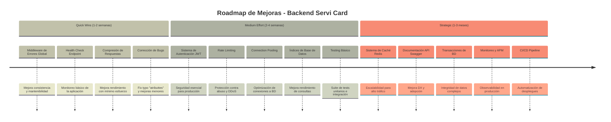
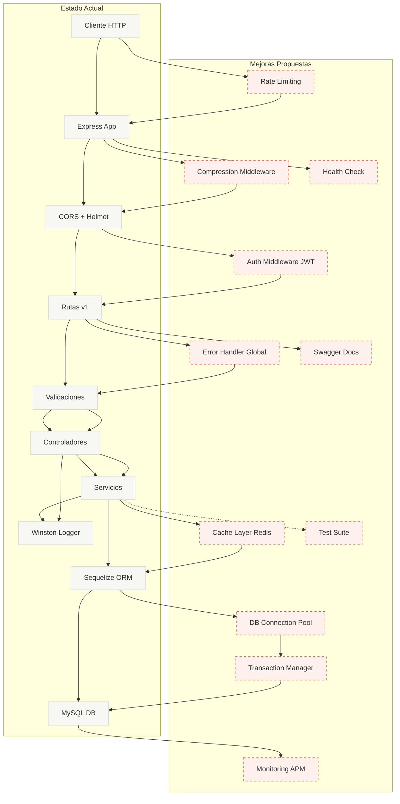

# Roadmap: Mejoras para Escalabilidad y Robustez

## 📊 Análisis del Estado Actual

### Fortalezas Identificadas

- ✅ Arquitectura en capas bien definida (Rutas → Controladores → Servicios → Modelos)
- ✅ Sistema de logging robusto con Winston y rotación de archivos
- ✅ Validación de datos con express-validator
- ✅ Seguridad básica con Helmet y CORS configurado
- ✅ Paginación implementada para evitar sobrecarga
- ✅ Validación de variables de entorno con envalid

### Áreas de Oportunidad

- ❌ **Autenticación y Autorización**: No implementada
- ❌ **Manejo de Errores Centralizado**: Inconsistente entre controladores
- ❌ **Caché**: No hay sistema de caché para consultas frecuentes
- ❌ **Rate Limiting**: Sin protección contra abuso de API
- ❌ **Testing**: No hay suite de tests implementada
- ❌ **Documentación API**: Falta Swagger/OpenAPI
- ❌ **Transacciones DB**: No se usan transacciones para operaciones complejas
- ❌ **Connection Pooling**: No configurado explícitamente
- ❌ **Health Checks**: Sin endpoint de monitoreo
- ❌ **Índices de BD**: Falta optimización de índices para búsquedas
- ❌ **Compresión**: Sin compresión de respuestas HTTP
- ❌ **Monitoreo/APM**: Sin sistema de monitoreo de aplicación

---

## 🗺️ Timeline de Mejoras



---

## 🔄 Diagrama: Estado Actual vs Propuesto



---

## 📋 Lista Priorizada de Mejoras

### 🔴 Quick Wins (Alto Impacto, Bajo Esfuerzo)

#### 1. Middleware de Manejo de Errores Global

**Prioridad:** Alta  
**Esfuerzo:** 2-4 horas  
**Impacto:** Alto

**Descripción:**
Crear un middleware centralizado para manejar todos los errores de forma consistente, eliminando código duplicado en controladores.

**Beneficios:**

- Respuestas de error consistentes
- Menos código duplicado
- Mejor mantenibilidad
- Logging centralizado de errores

**Implementación:**

```javascript
// middleware/errorHandler.js
const errorHandler = (err, req, res, next) => {
  logger.api.error("Error:", {
    message: err.message,
    stack: err.stack,
    path: req.path,
    method: req.method,
  });

  const statusCode = err.statusCode || 500;
  res.status(statusCode).json({
    error: {
      message: err.message || "Error interno del servidor",
      ...(process.env.ENVIRONMENT === "development" && { stack: err.stack }),
    },
  });
};
```

---

#### 2. Health Check Endpoint

**Prioridad:** Alta  
**Esfuerzo:** 1-2 horas  
**Impacto:** Medio-Alto

**Descripción:**
Endpoint `/health` para monitoreo de la aplicación y verificación de estado de servicios dependientes (BD, etc.).

**Beneficios:**

- Monitoreo básico de salud
- Integración con sistemas de orquestación (Kubernetes, Docker)
- Detección temprana de problemas

**Implementación:**

```javascript
// routes/health.js
router.get("/health", async (req, res) => {
  const healthCheck = {
    uptime: process.uptime(),
    message: "OK",
    timestamp: Date.now(),
    database: "disconnected",
  };

  try {
    await models.sequelize.authenticate();
    healthCheck.database = "connected";
    res.status(200).json(healthCheck);
  } catch (error) {
    healthCheck.database = "disconnected";
    res.status(503).json(healthCheck);
  }
});
```

---

#### 3. Compresión de Respuestas HTTP

**Prioridad:** Media  
**Esfuerzo:** 30 minutos  
**Impacto:** Medio

**Descripción:**
Implementar compresión gzip/brotli para reducir el tamaño de las respuestas HTTP.

**Beneficios:**

- Menor uso de ancho de banda
- Respuestas más rápidas
- Mejor experiencia de usuario

**Implementación:**

```javascript
const compression = require("compression");
app.use(compression());
```

---

#### 4. Corrección de Bugs y Mejoras Menores

**Prioridad:** Alta  
**Esfuerzo:** 1 hora  
**Impacto:** Medio

**Bugs Identificados:**

- Typo en `services/serviCard.js` línea 14: `atributtes` → `attributes`
- Uso inconsistente de `console.log` vs `logger` en controladores
- Falta validación de `null` en `getServiCardById`

---

### 🟡 Medium Effort (Impacto Medio-Alto, Esfuerzo Medio)

#### 5. Sistema de Autenticación JWT

**Prioridad:** Crítica  
**Esfuerzo:** 1-2 semanas  
**Impacto:** Crítico

**Descripción:**
Implementar autenticación basada en JWT para proteger los endpoints de la API.

**Componentes:**

- Modelo de Usuario
- Endpoints de registro/login
- Middleware de autenticación
- Refresh tokens
- Hash de contraseñas con bcrypt

**Beneficios:**

- Seguridad esencial para producción
- Control de acceso a recursos
- Auditoría de acciones de usuarios

**Estructura Propuesta:**

```
models/
  └── user.js
controllers/
  └── auth.js
middleware/
  └── authenticate.js
routes/
  └── auth.js
```

---

#### 6. Rate Limiting

**Prioridad:** Alta  
**Esfuerzo:** 4-8 horas  
**Impacto:** Alto

**Descripción:**
Implementar límites de tasa de solicitudes para prevenir abuso y ataques DDoS.

**Beneficios:**

- Protección contra abuso de API
- Prevención de ataques DDoS básicos
- Control de costos de infraestructura

**Implementación:**

```javascript
const rateLimit = require("express-rate-limit");

const apiLimiter = rateLimit({
  windowMs: 15 * 60 * 1000, // 15 minutos
  max: 100, // límite de 100 requests por IP
  message: "Demasiadas solicitudes desde esta IP",
});

app.use("/api/v1/", apiLimiter);
```

---

#### 7. Connection Pooling Optimizado

**Prioridad:** Media  
**Esfuerzo:** 2-4 horas  
**Impacto:** Medio-Alto

**Descripción:**
Configurar explícitamente el pool de conexiones de Sequelize para optimizar el rendimiento.

**Beneficios:**

- Mejor manejo de conexiones concurrentes
- Reducción de latencia
- Prevención de agotamiento de conexiones

**Implementación:**

```javascript
// config/config.js
const config = {
  pool: {
    max: 5,
    min: 0,
    acquire: 30000,
    idle: 10000,
  },
};
```

---

#### 8. Índices de Base de Datos

**Prioridad:** Media  
**Esfuerzo:** 2-3 horas  
**Impacto:** Medio-Alto

**Descripción:**
Crear índices en campos frecuentemente consultados para mejorar el rendimiento de las búsquedas.

**Índices Propuestos:**

- `patent` (búsquedas frecuentes)
- `date` (ordenamiento)
- `createdAt` (filtros temporales)

**Implementación:**

```javascript
// migrations/XXXX-add-indexes.js
await queryInterface.addIndex("ServiCars", ["patent"], {
  name: "idx_patent",
});
await queryInterface.addIndex("ServiCars", ["date"], {
  name: "idx_date",
});
```

---

#### 9. Suite de Testing

**Prioridad:** Alta  
**Esfuerzo:** 1-2 semanas  
**Impacto:** Alto

**Descripción:**
Implementar tests unitarios, de integración y end-to-end.

**Stack Propuesto:**

- Jest o Mocha para testing framework
- Supertest para testing de API
- Faker para datos de prueba

**Cobertura Objetivo:**

- Servicios: 80%+
- Controladores: 70%+
- Helpers: 90%+

**Estructura:**

```
tests/
  ├── unit/
  │   ├── services/
  │   └── helpers/
  ├── integration/
  │   └── api/
  └── fixtures/
```

---

### 🟢 Strategic (Alto Impacto, Alto Esfuerzo)

#### 10. Sistema de Caché con Redis

**Prioridad:** Media  
**Esfuerzo:** 1-2 semanas  
**Impacto:** Alto (a largo plazo)

**Descripción:**
Implementar caché con Redis para consultas frecuentes y reducir carga en la base de datos.

**Casos de Uso:**

- Caché de listados paginados
- Caché de búsquedas frecuentes
- Invalidación inteligente de caché

**Beneficios:**

- Reducción significativa de carga en BD
- Respuestas más rápidas
- Escalabilidad mejorada

**Implementación:**

```javascript
const redis = require("redis");
const client = redis.createClient();

const getCachedData = async (key) => {
  const cached = await client.get(key);
  return cached ? JSON.parse(cached) : null;
};

const setCachedData = async (key, data, ttl = 3600) => {
  await client.setEx(key, ttl, JSON.stringify(data));
};
```

---

#### 11. Documentación API con Swagger/OpenAPI

**Prioridad:** Media  
**Esfuerzo:** 1 semana  
**Impacto:** Medio-Alto

**Descripción:**
Generar documentación interactiva de la API usando Swagger/OpenAPI.

**Beneficios:**

- Mejor experiencia para desarrolladores
- Documentación siempre actualizada
- Testing interactivo de endpoints
- Generación automática de clientes SDK

**Stack Propuesto:**

- swagger-jsdoc
- swagger-ui-express

---

#### 12. Transacciones de Base de Datos

**Prioridad:** Media  
**Esfuerzo:** 3-5 días  
**Impacto:** Medio

**Descripción:**
Implementar transacciones para operaciones complejas que requieren consistencia.

**Casos de Uso:**

- Creación de múltiples registros relacionados
- Actualizaciones que afectan múltiples tablas
- Operaciones de eliminación en cascada

**Implementación:**

```javascript
const transaction = await models.sequelize.transaction();
try {
  await Model1.create(data1, { transaction });
  await Model2.create(data2, { transaction });
  await transaction.commit();
} catch (error) {
  await transaction.rollback();
  throw error;
}
```

---

#### 13. Monitoreo y APM (Application Performance Monitoring)

**Prioridad:** Media  
**Esfuerzo:** 1 semana  
**Impacto:** Alto (en producción)

**Descripción:**
Implementar sistema de monitoreo para métricas de rendimiento y alertas.

**Opciones:**

- Prometheus + Grafana
- New Relic
- Datadog
- Sentry (para errores)

**Métricas a Monitorear:**

- Tiempo de respuesta de endpoints
- Tasa de errores
- Uso de CPU/Memoria
- Conexiones a BD
- Throughput de requests

---

#### 14. CI/CD Pipeline

**Prioridad:** Media  
**Esfuerzo:** 1 semana  
**Impacto:** Alto (para equipo)

**Descripción:**
Automatizar pruebas, builds y despliegues.

**Componentes:**

- GitHub Actions / GitLab CI / Jenkins
- Tests automáticos
- Linting automático
- Build automático
- Despliegue automático (staging/production)

**Beneficios:**

- Reducción de errores humanos
- Despliegues más rápidos
- Mejor calidad de código
- Historial de cambios

---

## 🎯 Priorización Recomendada

### Fase 1: Estabilidad y Correcciones (Semanas 1-2)

1. ✅ Middleware de Errores Global
2. ✅ Health Check Endpoint
3. ✅ Corrección de Bugs
4. ✅ Compresión de Respuestas

### Fase 2: Seguridad y Performance (Semanas 3-6)

5. ✅ Sistema de Autenticación JWT
6. ✅ Rate Limiting
7. ✅ Connection Pooling
8. ✅ Índices de Base de Datos

### Fase 3: Calidad y Escalabilidad (Semanas 7-12)

9. ✅ Suite de Testing
10. ✅ Sistema de Caché Redis
11. ✅ Documentación Swagger

### Fase 4: Operaciones y Monitoreo (Semanas 13-16)

12. ✅ Transacciones de BD
13. ✅ Monitoreo y APM
14. ✅ CI/CD Pipeline

---

## 📊 Métricas de Éxito

### Performance

- **Tiempo de respuesta promedio:** < 200ms (p95)
- **Throughput:** > 1000 req/s
- **Uptime:** > 99.9%

### Calidad

- **Cobertura de tests:** > 80%
- **Tasa de errores:** < 0.1%
- **Tiempo de build:** < 5 minutos

### Seguridad

- **Vulnerabilidades críticas:** 0
- **Tiempo de respuesta a incidentes:** < 1 hora

---

## 🔗 Recursos y Referencias

### Documentación

- [Express Best Practices](https://expressjs.com/en/advanced/best-practice-performance.html)
- [Sequelize Transactions](https://sequelize.org/docs/v6/other-topics/transactions/)
- [JWT Best Practices](https://datatracker.ietf.org/doc/html/rfc8725)
- [Redis Caching Patterns](https://redis.io/docs/manual/patterns/)

### Herramientas Recomendadas

- **Testing:** Jest, Supertest
- **Caché:** Redis
- **Monitoreo:** Prometheus + Grafana
- **APM:** New Relic, Datadog
- **CI/CD:** GitHub Actions, GitLab CI
- **Documentación:** Swagger/OpenAPI

---

## 📝 Notas de Implementación

### Consideraciones Importantes

1. **Compatibilidad hacia atrás:** Mantener compatibilidad con versiones anteriores de la API durante las mejoras.

2. **Migración gradual:** Implementar mejoras de forma incremental, no todo a la vez.

3. **Testing en staging:** Siempre probar en ambiente de staging antes de producción.

4. **Documentación:** Actualizar README y documentación con cada mejora implementada.

5. **Monitoreo:** Establecer métricas baseline antes de implementar mejoras para medir el impacto.

---

**Última actualización:** Mayo 2024  
**Próxima revisión:** Trimestral
