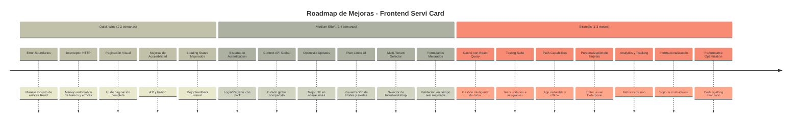
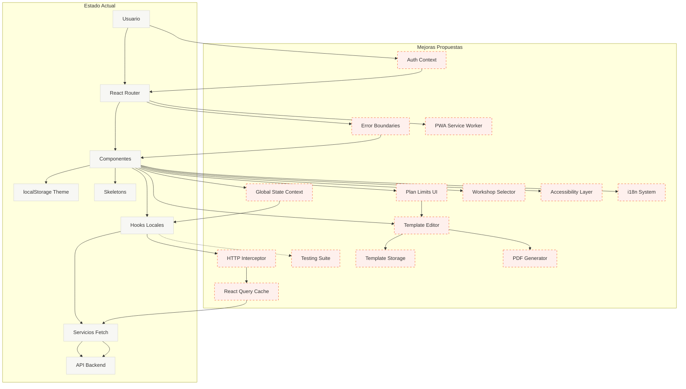

# Roadmap: Mejoras para Escalabilidad y Robustez - Frontend

## 📊 Análisis del Estado Actual

### Fortalezas Identificadas

- ✅ Arquitectura en capas bien definida (Componentes → Hooks → Servicios → API)
- ✅ Lazy loading de componentes para optimización inicial
- ✅ Debounce implementado en búsquedas
- ✅ Skeletons de carga para mejor UX
- ✅ Sistema de temas con DaisyUI y persistencia
- ✅ Separación clara de responsabilidades
- ✅ Validaciones de formularios implementadas

### Áreas de Oportunidad

- ❌ **Autenticación y Autorización**: No implementada
- ❌ **Manejo de Estado Global**: Solo estado local, sin Context/Redux
- ❌ **Manejo de Errores Centralizado**: Inconsistente entre componentes
- ❌ **Interceptores HTTP**: Sin manejo automático de tokens y errores
- ❌ **Paginación Visual**: Existe lógica pero no UI de paginación
- ❌ **Optimistic Updates**: Sin actualizaciones optimistas
- ❌ **Caché de Datos**: Sin caché en cliente
- ❌ **Testing**: No hay suite de tests implementada
- ❌ **Accesibilidad**: Sin consideraciones de a11y
- ❌ **PWA**: Sin capacidades de Progressive Web App
- ❌ **Multi-Tenant UI**: Sin selector de taller/workshop
- ❌ **Plan Limits UI**: Sin visualización de límites y alertas
- ❌ **Offline Support**: Sin soporte offline
- ❌ **Error Boundaries**: Sin manejo de errores de React

---

## 🗺️ Timeline de Mejoras



---

## 🔄 Diagrama: Estado Actual vs Propuesto



---

## 📋 Lista Priorizada de Mejoras

### 🔴 Quick Wins (Alto Impacto, Bajo Esfuerzo)

#### 1. Error Boundaries

**Prioridad:** Alta  
**Esfuerzo:** 2-3 horas  
**Impacto:** Alto

**Descripción:**
Implementar Error Boundaries de React para capturar errores de renderizado y mostrar UI de error amigable en lugar de pantalla blanca.

**Beneficios:**

- Prevención de crashes completos de la app
- Mejor experiencia de usuario ante errores
- Logging de errores para debugging
- Recuperación graceful de errores

**Implementación:**

```javascript
// components/ErrorBoundary.jsx
import { Component } from "react";

class ErrorBoundary extends Component {
  constructor(props) {
    super(props);
    this.state = { hasError: false, error: null };
  }

  static getDerivedStateFromError(error) {
    return { hasError: true, error };
  }

  componentDidCatch(error, errorInfo) {
    console.error("Error capturado:", error, errorInfo);
    // Enviar a servicio de logging
  }

  render() {
    if (this.state.hasError) {
      return (
        <div className="alert alert-error">
          <h2>Algo salió mal</h2>
          <p>{this.state.error?.message}</p>
          <button onClick={() => window.location.reload()}>
            Recargar página
          </button>
        </div>
      );
    }
    return this.props.children;
  }
}

// Uso en App.jsx
<ErrorBoundary>
  <Routes>...</Routes>
</ErrorBoundary>;
```

---

#### 2. Interceptor HTTP Centralizado

**Prioridad:** Alta  
**Esfuerzo:** 3-4 horas  
**Impacto:** Alto

**Descripción:**
Crear un servicio HTTP centralizado con interceptores para manejar automáticamente tokens JWT, errores comunes y retry logic.

**Beneficios:**

- Manejo automático de autenticación
- Respuestas de error consistentes
- Retry automático en fallos de red
- Logging centralizado de requests

**Implementación:**

```javascript
// services/httpClient.js
class HttpClient {
  constructor(baseURL) {
    this.baseURL = baseURL;
    this.interceptors = { request: [], response: [] };
  }

  // Interceptor de request
  addRequestInterceptor(interceptor) {
    this.interceptors.request.push(interceptor);
  }

  // Interceptor de response
  addResponseInterceptor(interceptor) {
    this.interceptors.response.push(interceptor);
  }

  async request(url, options = {}) {
    // Aplicar interceptors de request
    let config = { ...options };
    for (const interceptor of this.interceptors.request) {
      config = await interceptor(config);
    }

    // Agregar token si existe
    const token = localStorage.getItem("auth_token");
    if (token) {
      config.headers = {
        ...config.headers,
        Authorization: `Bearer ${token}`,
      };
    }

    try {
      const response = await fetch(`${this.baseURL}${url}`, config);

      // Aplicar interceptors de response
      let processedResponse = response;
      for (const interceptor of this.interceptors.response) {
        processedResponse = await interceptor(processedResponse);
      }

      // Manejar errores HTTP
      if (!response.ok) {
        if (response.status === 401) {
          // Token expirado, redirigir a login
          localStorage.removeItem("auth_token");
          window.location.href = "/login";
        }
        throw new Error(`HTTP ${response.status}: ${response.statusText}`);
      }

      return await processedResponse.json();
    } catch (error) {
      console.error("Request failed:", error);
      throw error;
    }
  }

  get(url, options) {
    return this.request(url, { ...options, method: "GET" });
  }

  post(url, data, options) {
    return this.request(url, {
      ...options,
      method: "POST",
      headers: {
        "Content-Type": "application/json",
        ...options?.headers,
      },
      body: JSON.stringify(data),
    });
  }

  delete(url, options) {
    return this.request(url, { ...options, method: "DELETE" });
  }
}

// Instancia singleton
export const httpClient = new HttpClient(import.meta.env.VITE_API_URL);

// Interceptor para manejar errores comunes
httpClient.addResponseInterceptor(async (response) => {
  if (!response.ok) {
    const error = await response.json().catch(() => ({}));
    throw new Error(error.message || "Error en la solicitud");
  }
  return response;
});
```

---

#### 3. Paginación Visual Completa

**Prioridad:** Media  
**Esfuerzo:** 2-3 horas  
**Impacto:** Medio-Alto

**Descripción:**
Implementar componente de paginación visual que muestre controles de navegación, información de página actual y total de páginas.

**Beneficios:**

- Mejor UX para navegar grandes conjuntos de datos
- Información clara de posición en los datos
- Navegación intuitiva

**Implementación:**

```javascript
// components/Pagination.jsx
export function Pagination({ currentPage, totalPages, onPageChange }) {
  const pages = Array.from({ length: totalPages }, (_, i) => i);

  return (
    <div className="join">
      <button
        className="join-item btn"
        disabled={currentPage === 0}
        onClick={() => onPageChange(currentPage - 1)}
      >
        «
      </button>
      {pages.map((page) => (
        <button
          key={page}
          className={`join-item btn ${
            currentPage === page ? "btn-active" : ""
          }`}
          onClick={() => onPageChange(page)}
        >
          {page + 1}
        </button>
      ))}
      <button
        className="join-item btn"
        disabled={currentPage === totalPages - 1}
        onClick={() => onPageChange(currentPage + 1)}
      >
        »
      </button>
    </div>
  );
}

// Uso en Home.jsx
const { currentPage, totalPages } = useServiCard();
const handlePageChange = (page) => {
  getServiCard(rows, search, page);
};

<Pagination
  currentPage={currentPage}
  totalPages={totalPages}
  onPageChange={handlePageChange}
/>;
```

---

#### 4. Mejoras de Accesibilidad (A11y)

**Prioridad:** Media  
**Esfuerzo:** 4-6 horas  
**Impacto:** Medio

**Descripción:**
Implementar mejoras básicas de accesibilidad: ARIA labels, navegación por teclado, contraste adecuado, y soporte para lectores de pantalla.

**Beneficios:**

- Cumplimiento de estándares WCAG
- Mejor experiencia para usuarios con discapacidades
- Mejor SEO
- Mejor UX general

**Implementaciones:**

```javascript
// Ejemplos de mejoras
// 1. ARIA labels en botones
<button aria-label="Eliminar tarjeta de servicio" onClick={handleDelete}>
  <svg>...</svg>
</button>;

// 2. Navegación por teclado
const handleKeyDown = (event) => {
  if (event.key === "Enter" || event.key === " ") {
    handleSubmit();
  }
};

// 3. Focus management en modales
useEffect(() => {
  if (isOpen) {
    modalRef.current?.focus();
  }
}, [isOpen]);

// 4. Contraste adecuado (verificar con herramientas)
// 5. Textos alternativos en imágenes
;
```

---

#### 5. Loading States Mejorados

**Prioridad:** Media  
**Esfuerzo:** 2-3 horas  
**Impacto:** Medio

**Descripción:**
Mejorar los estados de carga con spinners más informativos, progreso de operaciones y feedback visual mejorado.

**Implementación:**

```javascript
// components/LoadingSpinner.jsx
export function LoadingSpinner({ message = "Cargando..." }) {
  return (
    <div className="flex flex-col items-center justify-center p-8">
      <span className="loading loading-spinner loading-lg"></span>
      <p className="mt-4 text-sm opacity-70">{message}</p>
    </div>
  );
}

// components/ProgressBar.jsx
export function ProgressBar({ progress, message }) {
  return (
    <div>
      <progress
        className="progress progress-primary w-56"
        value={progress}
        max="100"
      ></progress>
      <p className="text-xs mt-2">{message}</p>
    </div>
  );
}
```

---

### 🟡 Medium Effort (Impacto Medio-Alto, Esfuerzo Medio)

#### 6. Sistema de Autenticación Completo

**Prioridad:** Crítica  
**Esfuerzo:** 1-2 semanas  
**Impacto:** Crítico

**Descripción:**
Implementar sistema completo de autenticación con login, registro, manejo de tokens JWT, refresh tokens y rutas protegidas.

**Componentes:**

1. **Páginas de Auth:**

   - Login
   - Register
   - Forgot Password
   - Reset Password

2. **Context de Autenticación:**

   - Estado global de usuario
   - Funciones de login/logout
   - Verificación de sesión

3. **Rutas Protegidas:**

   - ProtectedRoute component
   - Redirect automático si no autenticado

4. **Persistencia:**
   - Guardar token en localStorage
   - Refresh automático de tokens

**Implementación:**

```javascript
// context/AuthContext.jsx
import { createContext, useContext, useState, useEffect } from "react";

const AuthContext = createContext();

export function AuthProvider({ children }) {
  const [user, setUser] = useState(null);
  const [loading, setLoading] = useState(true);

  useEffect(() => {
    // Verificar token al cargar
    const token = localStorage.getItem("auth_token");
    if (token) {
      verifyToken(token);
    } else {
      setLoading(false);
    }
  }, []);

  const login = async (email, password) => {
    const response = await httpClient.post("/auth/login", { email, password });
    localStorage.setItem("auth_token", response.token);
    setUser(response.user);
    return response;
  };

  const logout = () => {
    localStorage.removeItem("auth_token");
    setUser(null);
  };

  return (
    <AuthContext.Provider value={{ user, login, logout, loading }}>
      {children}
    </AuthContext.Provider>
  );
}

export const useAuth = () => useContext(AuthContext);

// components/ProtectedRoute.jsx
export function ProtectedRoute({ children }) {
  const { user, loading } = useAuth();

  if (loading) return <LoadingSpinner />;
  if (!user) return <Navigate to="/login" />;

  return children;
}

// Uso en App.jsx
<Route
  path="/"
  element={
    <ProtectedRoute>
      <Home />
    </ProtectedRoute>
  }
/>;
```

---

#### 7. Context API para Estado Global

**Prioridad:** Alta  
**Esfuerzo:** 1 semana  
**Impacto:** Alto

**Descripción:**
Implementar Context API para estado global compartido: usuario, taller actual, plan, preferencias, etc.

**Beneficios:**

- Estado compartido sin prop drilling
- Mejor organización del estado
- Facilita implementación de multi-tenant

**Implementación:**

```javascript
// context/AppContext.jsx
export function AppProvider({ children }) {
  const [workshop, setWorkshop] = useState(null);
  const [plan, setPlan] = useState(null);
  const [preferences, setPreferences] = useState({
    theme: "business",
    language: "es",
  });

  return (
    <AppContext.Provider
      value={{
        workshop,
        setWorkshop,
        plan,
        setPlan,
        preferences,
        setPreferences,
      }}
    >
      {children}
    </AppContext.Provider>
  );
}
```

---

#### 8. Optimistic Updates

**Prioridad:** Media  
**Esfuerzo:** 3-5 días  
**Impacto:** Medio-Alto

**Descripción:**
Implementar actualizaciones optimistas para mejorar la percepción de velocidad: actualizar UI inmediatamente antes de confirmar con el servidor.

**Beneficios:**

- Mejor percepción de velocidad
- UX más fluida
- Menos espera para el usuario

**Implementación:**

```javascript
// hooks/useOptimisticUpdate.js
export function useOptimisticUpdate() {
  const [optimisticData, setOptimisticData] = useState(null);

  const updateOptimistically = async (updateFn, rollbackFn) => {
    // Actualizar UI inmediatamente
    setOptimisticData(updateFn());

    try {
      // Hacer request real
      await updateFn();
    } catch (error) {
      // Rollback en caso de error
      setOptimisticData(rollbackFn());
      throw error;
    }
  };

  return { optimisticData, updateOptimistically };
}

// Uso en componente
const handleDelete = async (id) => {
  const originalData = dataRow;

  // Actualizar UI inmediatamente
  setDataRow(dataRow.filter((card) => card.id !== id));

  try {
    await deletedServiCard(id);
  } catch (error) {
    // Rollback si falla
    setDataRow(originalData);
    showError("Error al eliminar");
  }
};
```

---

#### 9. Plan Limits UI y Alertas

**Prioridad:** Alta  
**Esfuerzo:** 1 semana  
**Impacto:** Alto (monetización)

**Descripción:**
Implementar UI para mostrar límites del plan actual, alertas cuando se aproximen a los límites, y CTAs para upgrade.

**Componentes:**

1. **Plan Limits Display:**

   - Barra de progreso por límite
   - Porcentaje usado
   - Límite máximo

2. **Alertas:**

   - Banner cuando se aproxime al límite (80%, 90%)
   - Modal cuando se exceda el límite
   - Mensajes claros de upgrade

3. **Upgrade CTA:**
   - Botones estratégicos para upgrade
   - Comparación de planes
   - Checkout flow

**Implementación:**

```javascript
// components/PlanLimits.jsx
export function PlanLimits({ limits, usage }) {
  const getPercentage = (used, max) => {
    if (!max) return 0;
    return Math.min((used / max) * 100, 100);
  };

  const getStatus = (percentage) => {
    if (percentage >= 100) return "error";
    if (percentage >= 90) return "warning";
    return "success";
  };

  return (
    <div className="card bg-base-200 p-4">
      <h3 className="font-bold mb-4">Límites del Plan</h3>
      {Object.entries(limits).map(([key, max]) => {
        const used = usage[key] || 0;
        const percentage = getPercentage(used, max);
        const status = getStatus(percentage);

        return (
          <div key={key} className="mb-4">
            <div className="flex justify-between mb-1">
              <span>{formatLimitName(key)}</span>
              <span>
                {used} / {max || "∞"}
              </span>
            </div>
            <progress
              className={`progress progress-${status} w-full`}
              value={percentage}
              max="100"
            ></progress>
            {percentage >= 90 && (
              <div className="alert alert-warning mt-2">
                <span>Estás cerca del límite. Considera hacer upgrade.</span>
                <Link to="/billing/upgrade" className="btn btn-sm">
                  Upgrade
                </Link>
              </div>
            )}
          </div>
        );
      })}
    </div>
  );
}
```

---

#### 10. Multi-Tenant Selector (Workshop Selector)

**Prioridad:** Alta  
**Esfuerzo:** 3-5 días  
**Impacto:** Alto

**Descripción:**
Implementar selector de taller/workshop para usuarios que pertenezcan a múltiples talleres.

**Componentes:**

1. **Workshop Selector:**

   - Dropdown con talleres disponibles
   - Cambio de contexto
   - Persistencia de selección

2. **Workshop Context:**
   - Context API para taller actual
   - Actualización automática de datos al cambiar

**Implementación:**

```javascript
// components/WorkshopSelector.jsx
export function WorkshopSelector() {
  const { workshops, currentWorkshop, setCurrentWorkshop } = useWorkshops();

  const handleChange = (workshopId) => {
    setCurrentWorkshop(workshopId);
    // Recargar datos del nuevo taller
    window.location.reload(); // O mejor: actualizar estado sin reload
  };

  return (
    <select
      className="select select-bordered"
      value={currentWorkshop?.id}
      onChange={(e) => handleChange(e.target.value)}
    >
      {workshops.map((workshop) => (
        <option key={workshop.id} value={workshop.id}>
          {workshop.name}
        </option>
      ))}
    </select>
  );
}
```

---

#### 11. Formularios Mejorados con Validación en Tiempo Real

**Prioridad:** Media  
**Esfuerzo:** 3-4 días  
**Impacto:** Medio

**Descripción:**
Mejorar formularios con validación en tiempo real, mensajes de error más claros y mejor UX.

**Implementación:**

```javascript
// hooks/useForm.js
export function useForm(initialValues, validations) {
  const [values, setValues] = useState(initialValues);
  const [errors, setErrors] = useState({});
  const [touched, setTouched] = useState({});

  const handleChange = (name, value) => {
    setValues({ ...values, [name]: value });

    // Validar en tiempo real después de tocar
    if (touched[name]) {
      const error = validations[name]?.(value);
      setErrors({ ...errors, [name]: error });
    }
  };

  const handleBlur = (name) => {
    setTouched({ ...touched, [name]: true });
    const error = validations[name]?.(values[name]);
    setErrors({ ...errors, [name]: error });
  };

  return { values, errors, touched, handleChange, handleBlur };
}
```

---

### 🟢 Strategic (Alto Impacto, Alto Esfuerzo)

#### 12. React Query para Caché y Gestión de Datos

**Prioridad:** Alta  
**Esfuerzo:** 1-2 semanas  
**Impacto:** Alto

**Descripción:**
Implementar React Query (TanStack Query) para gestión inteligente de caché, sincronización automática y mejor manejo de estado del servidor.

**Beneficios:**

- Caché automático de datos
- Refetch automático en background
- Optimistic updates integrados
- Menos código boilerplate
- Mejor manejo de loading/error states

**Implementación:**

```javascript
// hooks/useServiCardQuery.js
import { useQuery, useMutation, useQueryClient } from "@tanstack/react-query";

export function useServiCardQuery(rows, search, page) {
  const queryClient = useQueryClient();

  const { data, isLoading, error } = useQuery({
    queryKey: ["serviCards", rows, search, page],
    queryFn: () => getServiCardAll(rows, search, page),
    staleTime: 5 * 60 * 1000, // 5 minutos
  });

  const createMutation = useMutation({
    mutationFn: createServiCard,
    onSuccess: () => {
      // Invalidar caché para refrescar lista
      queryClient.invalidateQueries(["serviCards"]);
    },
  });

  const deleteMutation = useMutation({
    mutationFn: deleteServiCard,
    onMutate: async (id) => {
      // Cancelar queries en progreso
      await queryClient.cancelQueries(["serviCards"]);

      // Snapshot del estado anterior
      const previous = queryClient.getQueryData(["serviCards"]);

      // Optimistic update
      queryClient.setQueryData(["serviCards"], (old) =>
        old.filter((card) => card.id !== id)
      );

      return { previous };
    },
    onError: (err, id, context) => {
      // Rollback en error
      queryClient.setQueryData(["serviCards"], context.previous);
    },
    onSettled: () => {
      queryClient.invalidateQueries(["serviCards"]);
    },
  });

  return {
    data,
    isLoading,
    error,
    createCard: createMutation.mutate,
    deleteCard: deleteMutation.mutate,
  };
}
```

---

#### 13. Suite de Testing

**Prioridad:** Alta  
**Esfuerzo:** 2-3 semanas  
**Impacto:** Alto

**Descripción:**
Implementar tests unitarios, de integración y E2E para componentes, hooks y flujos críticos.

**Stack Propuesto:**

- Vitest (testing framework)
- React Testing Library
- MSW (Mock Service Worker) para mock de API
- Playwright o Cypress para E2E

**Cobertura Objetivo:**

- Componentes: 70%+
- Hooks: 80%+
- Helpers: 90%+
- Flujos críticos: 100%

**Estructura:**

```
tests/
  ├── unit/
  │   ├── components/
  │   ├── hooks/
  │   └── helpers/
  ├── integration/
  │   └── pages/
  └── e2e/
      └── flows/
```

---

#### 14. PWA Capabilities

**Prioridad:** Media  
**Esfuerzo:** 1 semana  
**Impacto:** Medio-Alto

**Descripción:**
Convertir la aplicación en Progressive Web App con service worker, caché offline, instalación y notificaciones push.

**Componentes:**

1. **Service Worker:**

   - Caché de assets estáticos
   - Estrategias de caché (Cache First, Network First)
   - Actualización automática

2. **Manifest:**

   - Configuración de PWA
   - Íconos y splash screens
   - Tema y colores

3. **Offline Support:**
   - Página offline
   - Sincronización cuando vuelva conexión
   - Queue de requests fallidos

**Implementación:**

```javascript
// vite.config.js - Agregar plugin PWA
import { VitePWA } from "vite-plugin-pwa";

export default defineConfig({
  plugins: [
    react(),
    VitePWA({
      registerType: "autoUpdate",
      includeAssets: ["favicon.ico", "robots.txt"],
      manifest: {
        name: "Servi Card",
        short_name: "ServiCard",
        description: "Gestión de tarjetas de servicio",
        theme_color: "#16a34a",
        icons: [
          {
            src: "pwa-192x192.png",
            sizes: "192x192",
            type: "image/png",
          },
          {
            src: "pwa-512x512.png",
            sizes: "512x512",
            type: "image/png",
          },
        ],
      },
    }),
  ],
});
```

---

#### 15. Analytics y Tracking

**Prioridad:** Media  
**Esfuerzo:** 3-5 días  
**Impacto:** Medio

**Descripción:**
Implementar tracking de eventos de usuario, métricas de uso y analytics para mejorar la aplicación.

**Opciones:**

- Google Analytics 4
- Mixpanel
- Plausible (privacy-friendly)
- Custom analytics

**Implementación:**

```javascript
// utils/analytics.js
export const trackEvent = (eventName, properties = {}) => {
  // Google Analytics
  if (window.gtag) {
    window.gtag("event", eventName, properties);
  }

  // Custom tracking
  fetch("/api/analytics", {
    method: "POST",
    body: JSON.stringify({ event: eventName, properties }),
  });
};

// Uso en componentes
const handleCreateCard = async () => {
  trackEvent("service_card_created", {
    workshop_id: currentWorkshop.id,
    plan: currentPlan.name,
  });
  await createCard();
};
```

---

#### 16. Internacionalización (i18n)

**Prioridad:** Baja  
**Esfuerzo:** 1-2 semanas  
**Impacto:** Medio (si se expande internacionalmente)

**Descripción:**
Implementar soporte multi-idioma usando react-i18next o similar.

**Implementación:**

```javascript
// i18n/config.js
import i18n from "i18next";
import { initReactI18next } from "react-i18next";

i18n.use(initReactI18next).init({
  resources: {
    es: { translation: require("./locales/es.json") },
    en: { translation: require("./locales/en.json") },
  },
  lng: "es",
  fallbackLng: "es",
});

// Uso en componentes
import { useTranslation } from "react-i18next";

function Home() {
  const { t } = useTranslation();
  return <h1>{t("welcome")}</h1>;
}
```

---

#### 17. Sistema de Personalización de Tarjetas (Enterprise)

**Prioridad:** Media-Alta  
**Esfuerzo:** 2-3 semanas  
**Impacto:** Alto (diferenciador competitivo)

**Descripción:**
Implementar sistema completo de personalización de tarjetas de servicio que permita a talleres del plan Enterprise crear, editar y aplicar plantillas personalizadas a sus tarjetas. Incluye editor visual, subida de plantillas, preview en tiempo real y gestión de múltiples plantillas.

**Características:**

1. **Editor Visual de Plantillas:**

   - Drag & drop de elementos
   - Personalización de colores, fuentes, logos
   - Posicionamiento de campos
   - Preview en tiempo real

2. **Subida de Plantillas:**

   - Carga de archivos (PDF, imágenes, HTML)
   - Validación de formatos
   - Almacenamiento en cloud storage

3. **Gestión de Plantillas:**

   - Múltiples plantillas por taller
   - Activar/desactivar plantillas
   - Duplicar y editar plantillas
   - Plantillas predeterminadas del sistema

4. **Aplicación de Plantillas:**
   - Seleccionar plantilla al crear tarjeta
   - Generación de PDF con diseño personalizado
   - Exportación con branding del taller

**Componentes Necesarios:**

1. **Editor de Plantillas:**

   ```javascript
   // components/TemplateEditor.jsx
   export function TemplateEditor({ template, onSave }) {
     const [design, setDesign] = useState(template?.design || defaultDesign);

     return (
       <div className="grid grid-cols-2 gap-4">
         <div className="editor-panel">
           <ColorPicker
             value={design.colors.primary}
             onChange={(color) =>
               setDesign({
                 ...design,
                 colors: { ...design.colors, primary: color },
               })
             }
           />
           <FontSelector
             value={design.font}
             onChange={(font) => setDesign({ ...design, font })}
           />
           <LogoUpload
             value={design.logo}
             onChange={(logo) => setDesign({ ...design, logo })}
           />
           <FieldPositioner
             fields={design.fields}
             onChange={(fields) => setDesign({ ...design, fields })}
           />
         </div>
         <div className="preview-panel">
           <TemplatePreview design={design} sampleData={sampleCardData} />
         </div>
       </div>
     );
   }
   ```

2. **Gestor de Plantillas:**

   ```javascript
   // pages/Templates.jsx
   export function Templates() {
     const { templates, loading } = useTemplates();
     const { plan } = usePlan();

     if (!plan.features.custom_templates) {
       return <UpgradeRequired feature="custom_templates" />;
     }

     return (
       <div>
         <h1>Mis Plantillas</h1>
         <button onClick={createNewTemplate}>Nueva Plantilla</button>
         <TemplateGrid templates={templates} />
       </div>
     );
   }
   ```

3. **Selector de Plantilla al Crear Tarjeta:**

   ```javascript
   // components/TemplateSelector.jsx
   export function TemplateSelector({ value, onChange }) {
     const { templates, activeTemplate } = useTemplates();

     return (
       <select value={value} onChange={(e) => onChange(e.target.value)}>
         <option value="default">Plantilla Predeterminada</option>
         {templates.map((template) => (
           <option key={template.id} value={template.id}>
             {template.name}
           </option>
         ))}
       </select>
     );
   }
   ```

4. **Preview de Tarjeta con Plantilla:**
   ```javascript
   // components/TemplatePreview.jsx
   export function TemplatePreview({ template, cardData }) {
     const renderedTemplate = useTemplateRenderer(template, cardData);

     return (
       <div className="template-preview">
         <div dangerouslySetInnerHTML={{ __html: renderedTemplate }} />
         <button onClick={generatePDF}>Generar PDF</button>
       </div>
     );
   }
   ```

**Stack Tecnológico Propuesto:**

- **Editor Visual:** React DnD o @dnd-kit para drag & drop
- **PDF Generation:** jsPDF o react-pdf
- **Image Processing:** react-image-crop para edición de logos
- **Storage:** Integración con S3/Cloudinary para almacenamiento
- **Template Engine:** Mustache.js o Handlebars para renderizado

**Beneficios:**

- Diferenciador competitivo fuerte
- Valor agregado para plan Enterprise
- Permite branding personalizado
- Mejora la experiencia del cliente final
- Facilita la identidad visual del taller

**Limitaciones por Plan:**

- **Starter/Professional:** Solo plantillas predeterminadas del sistema
- **Enterprise:** Plantillas personalizadas ilimitadas + editor visual

**Implementación Backend Requerida:**

- Endpoints para CRUD de plantillas
- Almacenamiento de archivos (logos, imágenes)
- Generación de PDFs con plantillas personalizadas
- Validación de permisos por plan

---

#### 18. Performance Optimization Avanzada

**Prioridad:** Media  
**Esfuerzo:** 1 semana  
**Impacto:** Medio-Alto

**Descripción:**
Optimizaciones avanzadas de rendimiento: code splitting más granular, lazy loading de rutas, memoización, virtualización de listas.

**Implementaciones:**

```javascript
// 1. Code splitting más granular
const HeavyComponent = lazy(() => import("./HeavyComponent"));

// 2. Memoización de componentes pesados
const ExpensiveComponent = memo(({ data }) => {
  // Componente costoso
});

// 3. Virtualización de listas grandes
import { useVirtualizer } from "@tanstack/react-virtual";

function VirtualizedList({ items }) {
  const parentRef = useRef();
  const virtualizer = useVirtualizer({
    count: items.length,
    getScrollElement: () => parentRef.current,
    estimateSize: () => 50,
  });

  return (
    <div ref={parentRef} style={{ height: "400px", overflow: "auto" }}>
      {virtualizer.getVirtualItems().map((virtualItem) => (
        <div key={virtualItem.key}>{items[virtualItem.index]}</div>
      ))}
    </div>
  );
}
```

---

## 🎯 Priorización Recomendada

### Fase 1: Estabilidad y UX Básica (Semanas 1-2)

1. ✅ Error Boundaries
2. ✅ Interceptor HTTP Centralizado
3. ✅ Paginación Visual Completa
4. ✅ Mejoras de Accesibilidad Básicas
5. ✅ Loading States Mejorados

### Fase 2: Autenticación y Estado Global (Semanas 3-6)

6. ✅ Sistema de Autenticación Completo
7. ✅ Context API para Estado Global
8. ✅ Optimistic Updates
9. ✅ Formularios Mejorados

### Fase 3: Multi-Tenant y Planes (Semanas 7-10)

10. ✅ Plan Limits UI y Alertas
11. ✅ Multi-Tenant Selector
12. ✅ Integración con backend multi-tenant

### Fase 4: Calidad y Escalabilidad (Semanas 11-16)

13. ✅ React Query para Caché
14. ✅ Suite de Testing
15. ✅ PWA Capabilities
16. ✅ Performance Optimization

### Fase 5: Crecimiento y Expansión (Semanas 17-22)

17. ✅ Analytics y Tracking
18. ✅ Sistema de Personalización de Tarjetas (Enterprise)
19. ✅ Internacionalización (si aplica)
20. ✅ Features avanzadas según feedback

---

## 📊 Métricas de Éxito

### Performance

- **First Contentful Paint:** < 1.5s
- **Time to Interactive:** < 3s
- **Lighthouse Score:** > 90
- **Bundle Size:** < 200KB (gzipped)

### UX

- **Error Rate:** < 0.1%
- **User Satisfaction:** > 4.5/5
- **Time to Complete Task:** < 30s

### Calidad

- **Test Coverage:** > 80%
- **Accessibility Score:** > 95
- **Browser Compatibility:** Chrome, Firefox, Safari, Edge

---

## 🔗 Recursos y Referencias

### Documentación

- [React Best Practices](https://react.dev/learn)
- [React Query Documentation](https://tanstack.com/query/latest)
- [Web Accessibility Guidelines](https://www.w3.org/WAI/WCAG21/quickref/)
- [PWA Best Practices](https://web.dev/progressive-web-apps/)

### Herramientas Recomendadas

- **State Management:** React Context API, Zustand (si se necesita más)
- **Data Fetching:** React Query (TanStack Query)
- **Testing:** Vitest, React Testing Library, Playwright
- **PWA:** vite-plugin-pwa
- **i18n:** react-i18next
- **Analytics:** Google Analytics, Plausible
- **Forms:** React Hook Form (mejora sobre validación manual)

---

## 📝 Notas de Implementación

### Consideraciones Importantes

1. **Compatibilidad con Backend:** Asegurar que todas las mejoras del frontend sean compatibles con los cambios del backend (multi-tenant, planes, etc.).

2. **Migración Gradual:** Implementar mejoras de forma incremental, probando cada cambio antes del siguiente.

3. **Testing Continuo:** Escribir tests junto con el código, no después.

4. **Performance Monitoring:** Monitorear métricas de rendimiento antes y después de cada optimización.

5. **User Feedback:** Recopilar feedback de usuarios reales para priorizar mejoras.

---

**Última actualización:** Mayo 2024  
**Próxima revisión:** Trimestral
